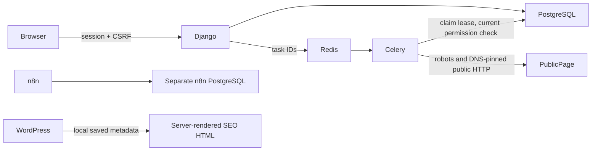

# Architecture

Current vertical slice: owner invitation → sign in → website business profile → staff site assignment → limited public-page audit → persisted job/evidence/issues. Reference input is separate from managed sites; adding a competitor URL never creates a publishing target.

PostgreSQL owns job state and idempotency. Redis transports IDs. Celery claims a lease, rechecks access, inspects robots policy before each page redirect hop, fetches bounded HTML, stores a limited excerpt and deterministic findings. Missing categories do not produce a manufactured health score. Audit runs only when explicitly requested; no business scheduler has been introduced.

WordPress 0.1 is independently installable and renders local metadata without Django. Its read-only REST contract is documented in API_CONTRACT.md. Django-to-WordPress encrypted connection setup, capability sync and Application Password HTTP smoke tests are next; local WP tests currently exercise REST permission callbacks in-process and rendered HTML over real HTTP.

The next deterministic publication slice must establish snapshots, immutable approval hashes, current policy checks, a remote durable idempotency ledger, timeout reconciliation and conflict-aware restoration before AI orchestration. LangGraph will own inner AI checkpoint state only, Celery execution and Django approvals remain authoritative. Gemini and Google require owner credentials later; no credentials have been requested merely to continue local work.
