> **2026-11-17 current update:** Gemini 3.5 Flash-Lite passed a real generation/research run. Google OAuth/property/metrics code and its n8n flow are implemented; real Google account setup is required. Read [today's results and next steps](NOV17_PROGRESS_SI.md) and [Google setup guide](GOOGLE_SEARCH_CONSOLE_CONNECT_SI.md). Older dated statements below are historical.

# Approval එකෙන් පසු සිදු වන දේ — Denim Yard

## කලින් approval එකෙන් පසු කිසිවක් නොවුණේ ඇයි?

Test draft `5bb1992d-ad03-4685-a5bf-4608cfe340a0` ඔබ edit කරලා submit කර තිබුණා. Submit කිරීම approval නොවේ. Creator හෝ last editor තමන්ගේම draft එක approve කිරීම policy එකෙන් තහනම් නිසා, ඒ draft එකට approval එකක් හෝ publication job එකක් සාදා තිබුණේ නැහැ.

දැන් interface එකේ මේ හේතුව පැහැදිලිව පෙන්වනවා; ක්‍රියාත්මක කළ නොහැකි approve button එක සඟවනවා. වෙනත් authorized reviewer කෙනෙකුට එම edited draft එක review කරන්න පුළුවන්. Agent විසින් එහි author වෙනස් කර හෝ self-approval rule ඉවත් කර නැහැ.

ඔබ පසුව දුන් explicit test authorization අනුව, වෙනම untouched assistant drafts සඳහා owner approval සහ `approval.user_message_authorized_test` audit event සටහන් කර සැබෑ staging tests කළා. ඒවා production approvals නොවේ. ඉදිරියේ සෑදෙන සෑම draft එකක්ම ඒ authorization එකෙන් ස්වයංක්‍රීයව approve වෙන්නේ නැහැ.

## Data ගමන් කරන පිළිවෙළ

```mermaid
flowchart LR
  A[Website URL + confirmed owner facts] --> B[Bounded page research]
  B --> C[Correct URL / WordPress target mapping]
  C --> D[Assistant metadata draft]
  D --> E[Exact field diff + human approval]
  E --> F[Durable publication queue]
  F --> G[WordPress metadata storage]
  G --> H[Connector renders HTML head]
  H --> I[Fetch actual URL and verify tags]
  I --> J[Verified result / explicit error]
```

Draft එක සෑදීමේදී current WordPress revision එක කියවනවා. Apply කිරීමට පෙර approval, permission, source evidence, target, pause සහ revision නැවත පරීක්ෂා කරනවා. පසුව ලැබුණු API response එක පමණක් success ලෙස සලකන්නේ නැහැ; URL එකේ ඇත්ත HTML එකත් පරීක්ෂා කරනවා.

## Meta tags save වෙන්නේ කොහේද?

| Target | WordPress storage | HTML output |
|---|---|---|
| Product / ordinary page / static front page | `wp_postmeta`: `_cseo_title`, `_cseo_description` | `<title>` සහ `<meta name="description">` |
| Dynamic homepage | `wp_options`: `_cseo_home_title`, `_cseo_home_description` | Homepage `<head>` tags |
| WooCommerce product category / blog category | `wp_termmeta`: `_cseo_title`, `_cseo_description` | අදාළ category archive `<head>` tags |

Plugin එක Open Graph සහ Twitter title/description සඳහාත් saved metadata fallback භාවිත කරනවා. Private `cseo_record` Custom Post Type එක review/history mirror එකයි. Idempotency සහ restore සඳහා transactional SQL ledger එක authoritative යි. CPT record edit කිරීම frontend tags වෙනස් කරන්නේ නැහැ.

Product ID `17` සහ category ID `17` එකම අංකය වුණත් වෙනස් objects දෙකක්. Adapter එක target kind + ID + URL වෙන් කරලා bind කරන නිසා category metadata එක product එකට යවන්නේ නැහැ. Visible product name, category name, H1, price, stock හෝ checkout fields මෙයින් edit කරන්නේ නැහැ.

## ඇත්තටම පරීක්ෂා කළ results

මේ සියල්ල `staging.denimyard.com` test copy එකේයි; live `denimyard.com` තවම production/paused, active plugin 0.1.0 සහ unchanged.

| Test target | Change ID | Result |
|---|---|---|
| Product #17 | `960d6813-3dc4-42ea-9ce9-f9e0746ae8d2` | Verified |
| Homepage #0 | `bbc06949-7a85-4336-9a87-b1288918446a` | Verified |
| Wide Leg category #17 | `128b0565-1467-4a44-b04d-6d7c3b13f638` | Verified |
| Women's Denim category #16 | `85911ddc-cdba-446e-8f72-29c1188eff69` | Verified |

Verified කියන්නේ HTTP 200, exact approved title/description, single title, duplicate canonical/robots checks සහ staging `noindex` ආරක්ෂාව ඇත්ත HTML එකෙන් තහවුරු වීමයි. මේක content quality හෝ Google ranking guarantee එකක් නොවේ. දැනට මේ drafts deterministic evidence-based starting suggestions; successful live Gemini generation එකක් ලෙස සලකන්න එපා.

## දැන් screen එකෙන් බලන පියවර

1. http://localhost:8000/sites/1/ — ප්‍රධාන Denim Yard workspace.
2. **Open Denim Yard test copy** — අදාළ test environment එක.
3. **Review drafts** — ඉහත Verified records විවෘත කර current/proposed values සහ HTML verification බලන්න.
4. අලුත් untouched assistant draft එකක් සඳහා **Approve & run on test copy** ඔබන්න. එම exact test draft එක approve කර queue එකට යවනවා.
5. Job status එක තත්පර දෙකකට වරක් update වෙනවා; terminal result ලැබුණාම page එක reload වී verification හෝ failure පෙන්වනවා. Poll limit එක අවසන් නම් Refresh status භාවිත කරන්න; approval නැවත නැවත submit කරන්න අවශ්‍ය නැහැ.
6. කලින් approved වූ draft එකක් paused නම් **Apply / retry approved test draft** මඟින් automation-management permission ඇති owner කෙනෙකුට test copy එක enable කර run කළ හැකියි. Approval/revision checks fail වුණොත් unpause වෙනස්කමත් rollback වෙනවා.

## n8n සහ Gemini දැන්

n8n: http://localhost:5679

URL research workflow: http://localhost:5679/workflow/sorf0b6a926a7744a329521fb8a953c59d2

Initial audit, scheduled audit dispatcher සහ URL research/drafts workflows තුන සකස් කර තිබෙනවා. Research workflow එක authenticated webhook/manual trigger සහ දින හතකට වරක් 06:00 Asia/Colombo refresh trigger එකක් භාවිත කරනවා. Research token එකට approve/publish/rollback permission නැහැ. Service credentials දින 30කින් expire වෙන නිසා ඒවා නැවත bind කළ යුතුයි.

සැබෑ n8n execution එකෙන් Django → Celery → research → pending-review drafts flow එක සාර්ථක වුණා. Container ready වීම සහ webhook register වීම වෙනස් බැවින් helper එක දැන් protected webhook readiness එකත් පරීක්ෂා කරනවා.

Gemini model authentication HTTP 200. `RESEARCH_AI_ENABLED=true` කර තිබෙනවා; අද organization calls පහම reserve වී ඇති නිසා generation නැවත charge කරන්නේ නැහැ. Latest n8n run එක `ai_budget_exhausted` report කර public research සහ rule-based drafts සාර්ථකව ලබාදුන්නා. Daily allowance අලුත් වූ පසු normal research එකෙන් generation පරීක්ෂා කළ හැකියි; provider timeout/503 නැවත එන්න පුළුවන්. Valid live Gemini generation තවම තහවුරු වී නැහැ.

## තව සම්පූර්ණ නැති දේ

Google Search Console property verification/account authorization/metrics සඳහා ඔබේ Google account setup අවශ්‍යයි. Google-issued TXT value invent කරන්න හෝ ඔබ වෙනුවෙන් Google login අනුමාන කරන්න බැහැ. Existing Google setup page එකේ පියවර භාවිත කරන්න.

Search-backed competitors/demand, අනෙකුත් operation workflows, content-body/Elementor adapters, expanded audits, reporting සහ production hardening තව ඉතිරියි. Production connector 0.3.0 update සහ live publication ද තව deploy කර නැහැ. Tested ZIP එක `dist/company-seo-connector-0.3.0.zip` තුළ තිබෙනවා. මේ milestone එකෙන් මුළු platform specification එක 100% complete වෙන්නේ නැහැ.

WordPress API references: [term metadata](https://developer.wordpress.org/reference/functions/update_term_meta/), [title filter](https://developer.wordpress.org/reference/hooks/document_title_parts/). n8n [Schedule Trigger](https://docs.n8n.io/integrations/builtin/core-nodes/n8n-nodes-base.scheduletrigger/) reference එක අනුව workflow timezone සහ publication අවශ්‍යතා සකස් කර තිබෙනවා.
